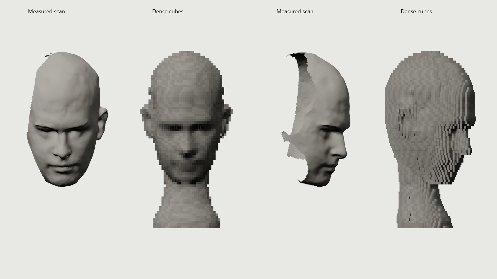

<p align="center"></p>
<h1 align="center">Artem Letyushev · Portfolio</h1>
<p align="center"><strong>An interactive portfolio for a Tech / Delivery Project Manager.</strong><br>Editorial storytelling, a sculpted 3D portrait, and evidence-led project work.</p>
<p align="center"><strong>English</strong> · <a href="README.ru.md">Русский</a></p>
<p align="center"><a href="https://artemletyushev.website">Live site</a> · <a href="docs/index.md">Documentation</a> · <a href="LICENSE">GPL-3.0 license</a></p>



## What is here

The site presents a professional profile in Russian, English, and Kazakh. Its static Astro pages remain readable without JavaScript; React and Three.js power three interactive islands: portrait, practice, and conveyor. A downloadable CV, contact links, localized metadata, agent-readable resources, and a real 404 page round out the experience. Claims and estimates follow the owner's approved profile.

## Built with

Astro 7 · React 19 · Three.js · JavaScript · CSS · Playwright · GitHub Pages. The visual direction was explored in Sketch and refined through a rapid, iterative design-and-build workflow. The author's agent-assisted workflow draws on [Impeccable](https://github.com/pbakaus/impeccable), [Test Designer](https://github.com/letya999/test-designer), [Test Critic](https://github.com/letya999/test-critic), [Probity](https://github.com/letya999/probity), and [AI Repo Safety](https://github.com/letya999/ai-repo-safety-skill). These are development aids, not runtime dependencies or guarantees.

## Run locally

Requires Node.js 22.23.4 or newer.

```sh
npm ci
cp .env.example .env
npm run dev
```

On Windows PowerShell, use `Copy-Item .env.example .env`. The local `.env` is ignored by Git. Set `SITE_URL` to the final HTTPS origin for production builds; analytics IDs are optional. The site needs no backend or API secret.

```sh
npm run build
npm run preview
npm test
```

`dist/` is the static deployment artifact. Browser checks use `npm run test:e2e` with a local Chrome installation. See the [runbook](docs/operations/runbook.md) for deployment, domain cutover, and verification.

## Project map

| Path | Purpose |
| --- | --- |
| `src/` | Astro shell, content, React islands, animation, and styles. |
| `public/` | CV, imagery, 3D data, agent resources, and third-party notices. |
| `scripts/generate-static.js` | Generate localized static resources from canonical content. |
| `tests/` | Browser and generated-output checks. |
| [`docs/`](docs/index.md) | Current product, architecture, and operations notes. |
| [`AGENTS.md`](AGENTS.md) | Project instructions for coding agents. |

Read the [product notes](docs/product.md), [architecture notes](docs/architecture.md), and [security notes](docs/security.md) before changing content or publishing assets.

## Deployment and analytics

GitHub Actions checks and builds `main` with Node.js 24, `npm ci`, `npm test`, and `npm run build`, then publishes `dist` to GitHub Pages. The workflow sets `SITE_URL=https://artemletyushev.website`. The custom domain is configured in repository Settings → Pages; Cloudflare manages DNS with DNS-only CNAME records for the apex and `www`, pointing to `letya999.github.io`. The [runbook](docs/operations/runbook.md) records verification and rollback.

Set `PUBLIC_GA_MEASUREMENT_ID` and/or `PUBLIC_YANDEX_METRIKA_ID` only after creating those counters and handling applicable privacy notice or consent requirements. Empty values omit the trackers. A successful build or deployment does not prove analytics collection, DNS propagation, or real-user performance.

## License and assets

Source code and original documentation: [GNU GPL v3.0](LICENSE). Supplied portraits and the CV belong to their respective rights holder and are not granted for reuse by that license. Fonts, icons, and 3D source assets retain the terms in `public/*LICENSE*`, `public/brand-marks/ATTRIBUTION.md`, `public/story/CREDITS.txt`, and `scripts/assets/webxr-hand.LICENSE.md`. The repository is public; the asset exclusions still apply.
